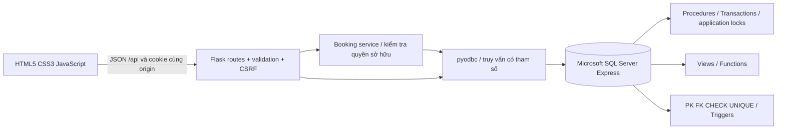
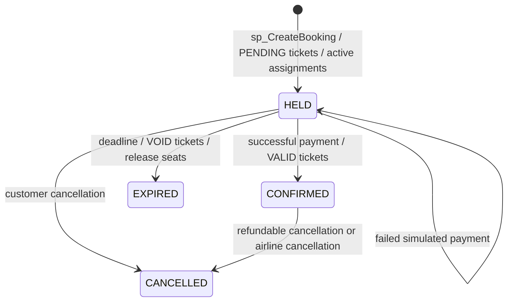

# Kiến trúc AeroFlow

## Thành phần và trách nhiệm

Frontend buildless, không cần Node để chạy. Flask phục vụ shell HTML, static assets và REST API cùng origin. Các module routes tách theo auth, flights, bookings, admin. `services/booking_service.py` chuẩn hóa passenger input và kiểm tra quyền sở hữu. `db.py` quản lý kết nối ngắn cho mỗi thao tác, commit/rollback/close và bind dấu `?`. Không ORM, không kết nối DB từ trình duyệt.

SQL Server xử lý tính tiền, cấp ghế, giữ ghế, phát hành vé, thanh toán, hoàn tiền và chuyển trạng thái. Backend chỉ truyền ID, hành khách và kết quả mô phỏng thanh toán. Cookie ký chỉ chứa user ID, session version, CSRF token và thời hạn; role/IsActive đọc từ DB mỗi request cần quyền.

Mỗi connection đặt `SESSION_CONTEXT('ActorID')` trước SQL để trigger ghi actor; luôn đặt cả NULL nếu không có người dùng, tránh actor cũ do connection pooling. Ngày giờ nghiệp vụ lưu UTC DATETIME2(0); frontend định dạng Asia/Ho_Chi_Minh. Ngày tìm kiếm là ngày Việt Nam được đổi sang khoảng UTC [đầu ngày, đầu ngày kế tiếp). Báo cáo tiền dùng ngày UTC và ghi rõ trên màn hình.

## Workflow và trạng thái

Không có trạng thái tự phát ở JavaScript. Mọi màn hình tải lại dữ liệu từ API sau thao tác. Tiền là Decimal trong Python và DECIMAL trong DB, JSON gửi tiền dạng chuỗi. UI chỉ định dạng số/giá dự kiến, procedure tự tính và chốt giá thật.

Hai thiết bị cùng chọn ghế không gây giữ ghế ngay. Chỉ khi gửi xác nhận đầy đủ hành khách, transaction mới tạo Booking, Passengers, BookingPassengers, FlightSeatAssignments, Tickets và AuditLogs. Một vé là 1 hành khách của 1 booking và 1 lượt cấp ghế. Transaction lỗi trả về không có booking dở dang.

## Các giới hạn có chủ đích

Một booking chứa một chuyến một chiều, từ 1–9 khách và hủy toàn bộ booking. Không nối chuyến, đổi vé, loyalty, email gửi thật hoặc payment gateway. Sơ đồ mô hình máy bay đã dùng cho chuyến được khóa. Chuyến có bất kỳ lịch sử booking nào không sửa lịch/máy bay: hủy và tạo mới nếu cần. Không xóa cứng hồ sơ có lịch sử, dùng trạng thái tài khoản/danh mục.

Giới hạn này giúp giữ nhất quán dữ liệu trong bài DBMS. Việc hủy chuyến của hãng hoàn 100%, hủy tự nguyện hoàn theo tỷ lệ snapshot và yêu cầu trước 24 giờ. BusinessRows nằm cuối máy bay trong dữ liệu mẫu để ghế A1 là phổ thông, phù hợp kịch bản giảng viên; đây là quy ước demo, không mô phỏng một mẫu máy bay thương mại cụ thể.

Waitress chạy localhost 8 threads; transaction database dùng READ COMMITTED và application lock Exclusive theo FlightID. Không giữ transaction mở trong thời gian người dùng điền form. Xem DATABASE_DESIGN.md cho thứ tự khóa, UNIQUE index và idempotency.
