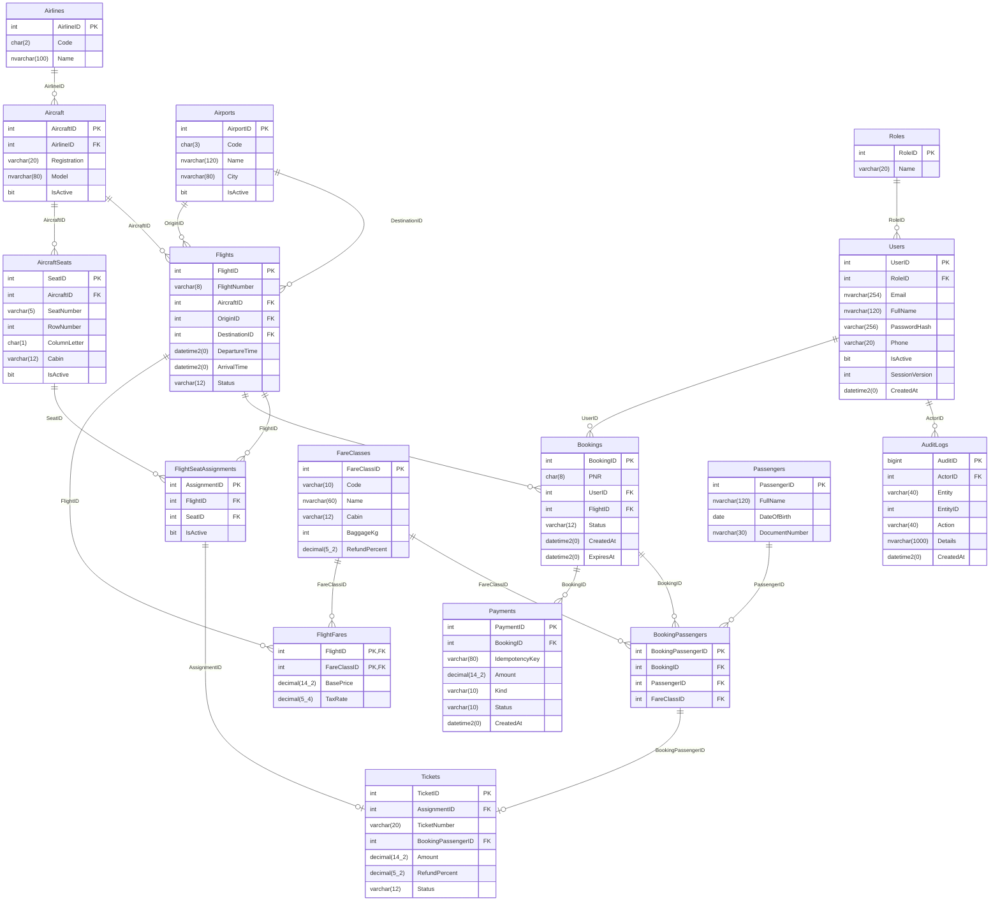

# ERD AeroFlow

Xem bản vector đầy đủ `docs/ERD.svg`. Kiểu tiền DECIMAL, thời gian UTC DATETIME2, chữ tiếng Việt NVARCHAR.

Vé liên kết một-một với BookingPassenger và Assignment bằng UNIQUE NOT NULL. Unique filtered index ở Assignment áp dụng cho FlightID + SeatID khi IsActive=1. Các trigger kiểm tra tính tương thích máy bay/ghế/cabin mà không lặp AircraftID,BookingID trên bảng cấp ghế.
