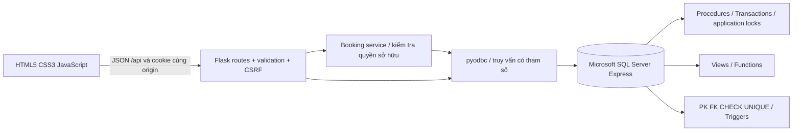
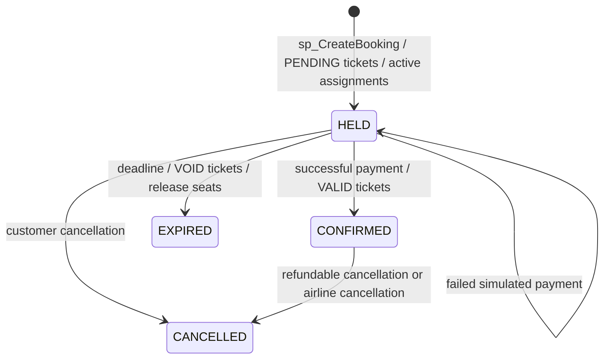

# 1. Mục tiêu và nguồn yêu cầu

AeroFlow là hệ thống đặt vé máy bay và quản trị lịch bay phục vụ bài tập lớn môn Hệ quản trị cơ sở dữ liệu. Mục tiêu là hiện thực một chuỗi chức năng thống nhất từ giao diện web, Flask API đến dữ liệu và giao dịch SQL Server. Trọng tâm là tính toàn vẹn dữ liệu, chuẩn hóa, các đối tượng T-SQL và khả năng chứng minh bằng kiểm thử.

Nguồn yêu cầu chính thức là tài liệu “Đề bài lớn - Thiết kế & triển khai Hệ quản trị CSDL (DBMS) tự chọn”, gồm 3 trang. Tài liệu yêu cầu tối thiểu 6 bảng chính, ràng buộc đầy đủ, dữ liệu mẫu, 10 truy vấn nghiệp vụ, 3 stored procedures, 2 functions, 3 views, ERD/3NF, README, báo cáo PDF và thuyết trình 10–15 phút. Bản AeroFlow triển khai 15 bảng nghiệp vụ cùng một bảng log, 18 truy vấn, 10 procedures, 2 functions và 4 views.

Yêu cầu bổ sung của đề tài gồm Customer Portal, Admin Dashboard, chọn ghế trực quan, giữ ghế có thời hạn, thanh toán mô phỏng, chống double booking, idempotency và kiểm thử đồng thời. Mọi dữ liệu nghiệp vụ hiển thị từ SQL Server, không có danh sách chuyến/giá giả trong JavaScript. Dữ liệu mẫu là dữ liệu giả lập có chủ đích trong database để demo, không phải dữ liệu hãng bay ngoài đời.

Phạm vi là chuyến bay nội địa một chiều, bay thẳng, tiền tệ VND. Một booking chứa tối đa 9 người, mỗi người có một ghế. Thanh toán không kết nối ngân hàng, không nhập hoặc lưu thẻ thật. Các quy tắc hủy và hoàn là giả định kỹ thuật của bài tập, không đại diện chính sách thương mại của một hãng.

Thông tin sinh viên/trường/lớp chưa được cung cấp nên để chỗ điền ở bìa. Người nộp cần hoàn thiện bìa và in, đóng quyển theo hướng dẫn giảng viên. Báo cáo này không tự xác nhận đã in hoặc nộp bài.


# 2. Kiến trúc và yêu cầu nghiệp vụ

## Thành phần và trách nhiệm



Frontend buildless, không cần Node để chạy. Flask phục vụ shell HTML, static assets và REST API cùng origin. Các module routes tách theo auth, flights, bookings, admin. `services/booking_service.py` chuẩn hóa passenger input và kiểm tra quyền sở hữu. `db.py` quản lý kết nối ngắn cho mỗi thao tác, commit/rollback/close và bind dấu `?`. Không ORM, không kết nối DB từ trình duyệt.

SQL Server xử lý tính tiền, cấp ghế, giữ ghế, phát hành vé, thanh toán, hoàn tiền và chuyển trạng thái. Backend chỉ truyền ID, hành khách và kết quả mô phỏng thanh toán. Cookie ký chỉ chứa user ID, session version, CSRF token và thời hạn; role/IsActive đọc từ DB mỗi request cần quyền.

Mỗi connection đặt `SESSION_CONTEXT('ActorID')` trước SQL để trigger ghi actor; luôn đặt cả NULL nếu không có người dùng, tránh actor cũ do connection pooling. Ngày giờ nghiệp vụ lưu UTC DATETIME2(0); frontend định dạng Asia/Ho_Chi_Minh. Ngày tìm kiếm là ngày Việt Nam được đổi sang khoảng UTC [đầu ngày, đầu ngày kế tiếp). Báo cáo tiền dùng ngày UTC và ghi rõ trên màn hình.

## Workflow và trạng thái



Không có trạng thái tự phát ở JavaScript. Mọi màn hình tải lại dữ liệu từ API sau thao tác. Tiền là Decimal trong Python và DECIMAL trong DB, JSON gửi tiền dạng chuỗi. UI chỉ định dạng số/giá dự kiến, procedure tự tính và chốt giá thật.

Hai thiết bị cùng chọn ghế không gây giữ ghế ngay. Chỉ khi gửi xác nhận đầy đủ hành khách, transaction mới tạo Booking, Passengers, BookingPassengers, FlightSeatAssignments, Tickets và AuditLogs. Một vé là 1 hành khách của 1 booking và 1 lượt cấp ghế. Transaction lỗi trả về không có booking dở dang.

## Các giới hạn có chủ đích

Một booking chứa một chuyến một chiều, từ 1–9 khách và hủy toàn bộ booking. Không nối chuyến, đổi vé, loyalty, email gửi thật hoặc payment gateway. Sơ đồ mô hình máy bay đã dùng cho chuyến được khóa. Chuyến có bất kỳ lịch sử booking nào không sửa lịch/máy bay: hủy và tạo mới nếu cần. Không xóa cứng hồ sơ có lịch sử, dùng trạng thái tài khoản/danh mục.

Giới hạn này giúp giữ nhất quán dữ liệu trong bài DBMS. Việc hủy chuyến của hãng hoàn 100%, hủy tự nguyện hoàn theo tỷ lệ snapshot và yêu cầu trước 24 giờ. BusinessRows nằm cuối máy bay trong dữ liệu mẫu để ghế A1 là phổ thông, phù hợp kịch bản giảng viên; đây là quy ước demo, không mô phỏng một mẫu máy bay thương mại cụ thể.

Waitress chạy localhost 8 threads; transaction database dùng READ COMMITTED và application lock Exclusive theo FlightID. Không giữ transaction mở trong thời gian người dùng điền form. Xem DATABASE_DESIGN.md cho thứ tự khóa, UNIQUE index và idempotency.


# 3. Thiết kế, chuẩn hóa và toàn vẹn dữ liệu

## ERD và từ điển dữ liệu

Xem `ERD.md`, `docs/ERD.mmd`, `docs/ERD.svg` và `docs/DATA_DICTIONARY.md`. Từ điển lấy trực tiếp từ metadata SQL Server sau khi chạy DDL. Hệ thống có 16 bảng, trong đó 15 bảng nghiệp vụ và 1 bảng log. Bảng danh mục nhỏ như Roles không bị tăng giả lên 30 bản ghi. Các bảng Flights, Users, Passengers, Bookings, BookingPassengers, Tickets, Payments có 30–200 bản ghi mẫu; FlightFares và AircraftSeats nhiều hơn do quan hệ dữ liệu tự nhiên.

## Chuẩn hóa

Mô hình thô có thể là một dòng đặt vé chứa email, tên khách, hãng bay, mã sân bay, máy bay, danh sách hành khách/ghế, số tiền và giao dịch. Dạng này lặp danh mục và khó cập nhật một phần.

1. **1NF:** tách mỗi hành khách/ghế/vé/thanh toán thành bản ghi riêng, không lưu danh sách ghế hay hành khách trong một cột. JSON chỉ là tham số transport của procedure, không phải cấu trúc lưu trữ nghiệp vụ.
2. **2NF:** FlightFares có khóa (FlightID, FareClassID); BasePrice/TaxRate phụ thuộc cả chuyến và hạng, còn tên hạng, cabin, hành lý ở FareClasses. AircraftSeats giữ hàng/cột thuộc từng máy bay, không giả định A1 đồng nhất giữa mọi máy bay.
3. **3NF:** tên sân bay/thành phố chỉ ở Airports; hãng bay thuộc Aircraft qua AirlineID, không lặp AirlineID trên Flights; thông tin tài khoản ở Users, quyền ở Roles. Bookings tham chiếu User và Flight. BookingPassengers nối Booking với Passenger/FareClass. Tickets tham chiếu BookingPassenger và Assignment bằng hai khóa UNIQUE. FlightSeatAssignments chỉ giữ FlightID, SeatID và IsActive, không lặp BookingID/PassengerID/AircraftID. Như vậy không có chuỗi phụ thuộc bắc cầu giữa các thuộc tính không khóa trong cùng bảng.

Các quan hệ chức năng tiêu biểu: UserID → Email, FullName, RoleID; FlightID → AircraftID, OriginID, DestinationID, thời gian; (FlightID,FareClassID) → BasePrice,TaxRate; SeatID → AircraftID,RowNumber,ColumnLetter,Cabin; BookingPassengerID → BookingID,PassengerID,FareClassID; TicketID/BookingPassengerID/AssignmentID/TicketNumber (mỗi giá trị là candidate key trong Tickets) → Amount,RefundPercent,Status.

Amount và RefundPercent trên Tickets là **điều khoản lịch sử tại lúc đặt**, không phải bản sao đồng nghĩa của giá hoặc tỷ lệ hiện hành. Sửa bảng giá không đổi vé cũ. Passengers được ghi như hồ sơ hành khách bất biến tại lần đặt, cho phép cùng giấy tờ xuất hiện trong những booking khác nhau mà không sửa ngược lịch sử. Email user là duy nhất; DocumentNumber không duy nhất toàn hệ thống vì hồ sơ hành khách là snapshot theo lần mua. Trong cùng booking, procedure từ chối giấy tờ trùng.

Booking không lưu tổng tiền dư thừa: view cộng Tickets.Amount. Aircraft không lưu số ghế: view đếm AircraftSeats. Tỷ lệ lấp đầy = vé VALID có assignment active / số ghế active của máy bay, chỉ phản ánh ghế đã thanh toán, không tính ghế đang giữ. Doanh thu ròng = CHARGE SUCCESS − REFUND SUCCESS theo ngày nhận tiền.

## Quan hệ

- 1–N: Roles–Users; Airlines–Aircraft; Aircraft–AircraftSeats/Flights; Airports–Flights hai vai trò đi/đến; Users–Bookings; Flights–Bookings/FlightFares/Assignments; Bookings–BookingPassengers/Payments; FareClasses–BookingPassengers.
- N–N: Flights–FareClasses qua FlightFares; Bookings–Passengers qua BookingPassengers; Flights–AircraftSeats qua lịch sử FlightSeatAssignments.
- 1–1 bắt buộc về phía vé: mỗi Ticket tham chiếu đúng một BookingPassenger và một Assignment qua UNIQUE NOT NULL. Việc tạo ba bản ghi diễn ra cùng transaction; FK đơn lẻ không ép một BP phải có vé ngay ở giữa transaction.
- ActorID trên AuditLogs cho phép NULL cho seed/scheduler. Không ghi password, document đầy đủ hoặc payload trong log.

## Ràng buộc và index

16 PRIMARY KEY, 19 FOREIGN KEY, 19 UNIQUE constraints, 27 CHECK, 14 DEFAULT tại lần kiểm chứng. NOT NULL ở mọi cột nghiệp vụ bắt buộc. CHECK bao phủ lộ trình khác điểm, thời gian đến sau khởi hành, giá/thuế/tỷ lệ hoàn hợp lệ, tập trạng thái, cabin/hàng/cột và số ghế. Bằng chứng metadata ở `evidence/database-inventory.json`.

`UX_Assignments_ActiveSeat(FlightID,SeatID) WHERE IsActive=1` là hàng rào cuối chống hai lượt cấp ghế còn hiệu lực. Assignment lịch sử giữ lại với IsActive=0 nên có thể bán lại sau hủy/hết hạn. `UX_Payments_SuccessCharge(BookingID)` chỉ CHARGE SUCCESS; `UX_Payments_Refund(BookingID)` chỉ REFUND; `UQ_Payments_Key` bảo vệ idempotency key toàn cục.

`IX_Flights_Search(OriginID,DestinationID,DepartureTime)` phục vụ tìm chuyến theo route/date range và INCLUDE các cột hiển thị. `IX_Bookings_Expiry` phục vụ dọn giữ ghế; `IX_Bookings_User` phục vụ lịch sử; `IX_Payments_Report` hỗ trợ báo cáo theo thời gian; `IX_BP_Booking` hỗ trợ cộng tiền; `IX_Audit_Created` phục vụ nhật ký mới nhất. Không tạo index theo cảm tính trên mọi cột. Với bộ dữ liệu nhỏ, chi phí view correlated subquery vẫn phù hợp; chưa đo tải sản xuất, nên xem actual execution plan và STATISTICS IO khi tăng dữ liệu.

## Khóa và transaction

Connection dùng READ COMMITTED mặc định. Các procedure bật SET XACT_ABORT ON và BEGIN TRY/CATCH; lỗi rollback toàn bộ nếu còn transaction. sp_LockFlight dùng `sp_getapplock` Exclusive, LockOwner=Transaction, resource `AeroFlow:flight:<FlightID>`, timeout 10 giây. Tất cả tác vụ làm thay đổi quyền sở hữu ghế dùng cùng resource: đặt, thanh toán, hủy, expire, status, giá. Lock tự nhả khi transaction kết thúc. UPDLOCK/HOLDLOCK bảo vệ đọc quyết định trong create booking, bổ sung unique filtered index cho phòng vệ trực tiếp ở DB.

Luồng tranh ghế: T1 giữ khóa chuyến, kiểm tra ghế và chèn assignment; T2 đợi. T1 commit; T2 nhận khóa, thấy assignment active, trả SQL_51005/HTTP409. Nếu T1 lỗi, rollback loại bỏ toàn bộ rows và T2 có thể thành công. Unique index còn từ chối hai assignment active ngay cả khi một writer bỏ qua application lock.

Khóa theo chuyến (thay vì từng ghế) đơn giản hóa chứng minh đúng đắn và tránh thứ tự khóa ghế khác nhau ở nhóm nhiều khách. Đổi lại, thông lượng một chuyến bị tuần tự hóa. Admin sửa lịch lấy khóa lịch toàn cục rồi khóa chuyến; các luồng booking không lấy khóa lịch nên không đảo thứ tự. Catalog aircraft/seat chỉ sửa trước khi có chuyến. SQL Server vẫn có thể phát hiện deadlock ở writer bên ngoài: API trả 409 để thử lại, không tự động lặp một booking có thể đã commit.

sp_ExpireFlightHolds cập nhật booking EXPIRED, vé VOID, assignment inactive cùng transaction. Đọc availability loại trừ hold hết hạn theo đồng hồ SQL trước cả lúc job chạy. Khi chọn ghế/procedure tạo mới, cleanup chạy dưới cùng khóa và giải phóng physical unique index. Thanh toán chạy cleanup rồi khóa lại và kiểm tra thời hạn lần nữa, nên không thể trả tiền cho một hold đã hết hạn trong khoảng giữa hai bước.

## Idempotency và rollback

Client tạo UUID cho mỗi lần thanh toán; giữ key trong sessionStorage cho đến khi nhận phản hồi. Nếu mất mạng, gửi lại cùng key/cùng booking/cùng Success sẽ nhận lại PaymentID. Dùng key cũ cho booking khác hoặc kết quả khác bị từ chối. Khi booking đã CONFIRMED, key mới không tạo CHARGE thứ hai. Hai request đồng thời cùng key dùng khóa chuyến và unique constraints để trả một giao dịch duy nhất.

Failed payment là bản ghi FAILED, booking vẫn HELD đến deadline. Customer cancellation lặp không tạo REFUND lần hai; refund key ổn định theo booking và filtered unique index. Hãng hủy chuyến trả 100% cho booking CONFIRMED, không hoàn cho hold chưa thu tiền. Hoàn bằng 0 vẫn được ghi để thể hiện vé không hoàn.

Kiểm thử rollback cài trigger lỗi **chỉ trong DB test** tại INSERT Tickets, sau khi Booking/Passenger/BP/Assignment đã được chèn. Đếm 6 bảng trước và sau phải bằng nhau, gồm AuditLogs; trigger lỗi được gỡ trong finally. Đây là minh chứng rollback thực, không chỉ lỗi validation trước khi transaction bắt đầu.

## Triggers có phạm vi cụ thể

tr_Bookings_Audit và tr_Flights_Audit ghi thay đổi, đồng thời ngăn thay Flight/aircraft làm sai ghế đã cấp. tr_Seats_ImmutableLayout chặn sửa sơ đồ của máy bay đã có chuyến. tr_Assignments_Integrity kiểm tra ghế thuộc đúng máy bay và không đổi liên kết assignment. tr_Tickets_Integrity kiểm tra Flight/Cabin/booking và bảo vệ giá/liên kết vé đã tạo. tr_Payments_Audit ghi CHARGE/REFUND. Không dùng trigger để tự phát hành vé hoặc tự tính tiền; business procedure thể hiện rõ thứ tự thao tác.

## Tài liệu kỹ thuật tham khảo

- Microsoft, [sp_getapplock](https://learn.microsoft.com/en-us/sql/relational-databases/system-stored-procedures/sp-getapplock-transact-sql): khóa ứng dụng thuộc transaction.
- Microsoft, [Filtered indexes](https://learn.microsoft.com/en-us/sql/relational-databases/indexes/create-filtered-indexes): giới hạn tập row còn hiệu lực.
- Microsoft, [TRY...CATCH](https://learn.microsoft.com/en-us/sql/t-sql/language-elements/try-catch-transact-sql), [XACT_ABORT](https://learn.microsoft.com/en-us/sql/t-sql/statements/set-xact-abort-transact-sql).


# 4. Các đối tượng T-SQL và ứng dụng thực tế

| Đối tượng | Vai trò | Nơi sử dụng |
|---|---|---|
| vw_FlightAvailability | Lịch bay, tuyến, giá từ, số ghế khả dụng | Trang chủ, tìm kiếm, chi tiết chuyến |
| vw_BookingDetails | Booking, tổng tiền từ vé, hành khách, hành trình | Lịch sử khách và quản trị |
| vw_MonthlyRevenue | Tiền thu, hoàn, ròng theo tháng | Dashboard |
| vw_FlightOccupancy | Vé hợp lệ và tổng ghế từng chuyến | Dashboard và occupancy function |
| fn_CalculateTicketPrice | Làm tròn giá cơ sở nhân (1 + thuế) | Tạo vé, API chi tiết, Q16 |
| fn_GetFlightOccupancyRate | Phần trăm ghế VALID/ghế active | Dashboard, Q16 |
| sp_CreateBooking | Giữ ghế, tạo PNR/hành khách/vé nguyên tử | POST /bookings và seed |
| sp_ConfirmPayment | Payment idempotent, phát hành vé | POST /payments và seed |
| sp_CancelBooking | Hủy và hoàn theo điều kiện đã chốt | POST /cancel và seed |
| sp_GetAvailableSeats | Dọn hold hết hạn và trả sơ đồ | UI chọn ghế |
| sp_ExpireFlightHolds | EXPIRED/VOID và release đồng bộ | Requests và scheduler |
| sp_GetRevenueReport | Tiền theo ngày UTC, có From/To | Màn hình doanh thu |
| sp_UpdateFlightStatus | Đóng bán/hủy chuyến và hoàn đủ | Admin |
| sp_SaveFlight | Chặn lịch trùng, bảo vệ lịch đã có booking | Admin tạo/sửa lịch |
| sp_SaveFare | Bảng giá hiện hành, khóa cùng chuyến | Admin giá vé |
| sp_LockFlight | Khóa ứng dụng thuộc transaction | Procedure dùng nội bộ |

Các view là giao diện đọc và tổng hợp nhiều bảng. WITH CHECK OPTION không cần thiết vì không có endpoint cập nhật qua view. Constraints thuộc bảng gốc và trigger bảo vệ liên kết. Các function là scalar UDF được gọi thực, không tạo chỉ để đủ số lượng đối tượng.

sp_CreateBooking nhận UserID, FlightID và JSON danh sách hành khách, có BookingID OUTPUT; JSON được tách bằng OPENJSON rồi insert các bảng chuẩn hóa. sp_ConfirmPayment nhận key và boolean mô phỏng, không nhận giá cần tin cậy. sp_GetRevenueReport dùng tham số ngày rõ ràng. Cách dùng IN/OUT giúp trình diễn T-SQL đồng thời giữ API đơn giản.

Trigger thực hiện hai nhóm chức năng có phạm vi: ghi audit và kiểm tra các quy tắc liên bảng không thể biểu diễn bằng CHECK thông thường. Trigger không tự quyết định thanh toán hoặc tạo vé. Ví dụ tr_Assignments_Integrity kiểm tra SeatID thuộc AircraftID của FlightID; Tickets không lặp các khóa bắc cầu này chỉ để tạo một FK tổng hợp.


# 5. Truy vấn nghiệp vụ

18 truy vấn trong 09_business_queries.sql đã thực thi trên SQL Server; sql-checks.json ghi số result set và row trả về. Bộ truy vấn dùng dữ liệu thật của ứng dụng và bao phủ đầy đủ cú pháp nêu trong đề.

| Query | Cú pháp chính | Câu hỏi nghiệp vụ |
|---|---|---|
| Q01 | SELECT * | Danh sách sân bay |
| Q02 | INNER JOIN | Chuyến bay, điểm đi/đến, máy bay nào |
| Q03 | LEFT JOIN | Mỗi khách có bao nhiêu booking, kể cả 0 |
| Q04 | RIGHT JOIN | Sân bay có bao nhiêu chuyến đi, kể cả 0 |
| Q05 | FULL OUTER JOIN | Đối chiếu lượt đi/đến ở các sân bay |
| Q06 | GROUP BY + HAVING | Tuyến nào có ít nhất 10 chuyến |
| Q07 | Scalar subquery | Giá nào cao hơn giá cơ sở trung bình |
| Q08 | Table subquery | Ghép kết quả đếm booking theo khách |
| Q09 | UNION | Hợp các sân bay đã có phục vụ |
| Q10 | INTERSECT | Sân bay vừa có chuyến đến vừa có chuyến đi |
| Q11 | EXCEPT | Sân bay chưa có chuyến đi |
| Q12 | LIKE Unicode | Tìm khách mẫu theo tên |
| Q13 | BETWEEN | Hạng vé trong khoảng giá |
| Q14 | TOP PERCENT WITH TIES | Nhóm giá cao nhất, giữ các giá bằng nhau |
| Q15 | View aggregation | Doanh thu theo tháng |
| Q16 | Scalar functions | Giá đã thuế và tỷ lệ ghế |
| Q17 | Stored procedure | Báo cáo theo khoảng ngày |
| Q18 | Correlated NOT EXISTS | Ghế chưa có assignment hiệu lực |

Ví dụ nghiệp vụ về sân bay chưa có chuyến đi:

```sql
SELECT AirportID FROM dbo.Airports
EXCEPT
SELECT OriginID FROM dbo.Flights;
```

Ví dụ tuyến có ít nhất 10 chuyến:

```sql
SELECT OriginID, DestinationID, COUNT(*) AS Flights
FROM dbo.Flights
GROUP BY OriginID, DestinationID
HAVING COUNT(*) >= 10;
```

Khi thuyết trình, đối chiếu một query trực tiếp trong SSMS và phần UI tương ứng. Không đánh đồng truy vấn ví dụ SELECT * với lựa chọn truy vấn production tối ưu ở mọi trường hợp. Schema nhỏ phù hợp demo; cần actual execution plan khi khối lượng tăng.


# 6. Kiểm thử và bằng chứng

## Môi trường và phạm vi

Ngày 12/10/2026 (Asia/Ho_Chi_Minh), Windows, Python 3.12, Flask 3.1.2, pyodbc 5.3.0, Microsoft ODBC Driver 18, SQL Server 2022 Express 16.0.1000.6. Không mock database trong integration suite. Database test riêng `AeroFlow_Test_Final_20261012`, tách khỏi DB phục vụ kiểm tra UI.

**Lần chạy cuối: 39 passed, 0 failed, 0 skipped, 35.77 giây.** Đây là kết quả pytest từ `evidence/pytest-output.txt` và `evidence/pytest-results.xml`, không phải cam kết mọi trường hợp đều an toàn hoặc đã đạt kiểm thử production.

17 test unit/security (bao gồm các trường hợp parameterized) và 22 test tích hợp SQL Server. `test_unavailable_database_safe_response` cố ý giả lập lỗi connect ở unit test để kiểm tra phản hồi 503 không lộ bí mật; test đó không chứng minh mất kết nối mạng thật. Các integration test sử dụng connection SQL Server thật và có commit/rollback thật.

## Các trường hợp đã chạy đạt

| Nhóm | Bằng chứng |
|---|---|
| Đăng ký, trùng email, mật khẩu sai, đăng nhập, logout | test_registration_login_logout; xác nhận hash scrypt trong DB |
| Chưa login, Customer bị chặn Admin, admin đọc báo cáo | test_unauthenticated_endpoints; test_roles_and_admin_views |
| Tìm chuyến, giá function, chi tiết, 12 ghế test | test_search_and_details |
| Tạo booking, không nhận giá do frontend tự khai | test_booking_uses_database_price_and_seat_conflict |
| Hai khách đặt cùng ghế đồng thời | Barrier + 2 clients: một 201, một 409; active count=1 |
| Unique index chặn writer trực tiếp | test_filtered_unique_index_blocks_direct_double_assignment |
| Đặt hai hành khách nguyên tử | test_group_booking_atomic_total; 2 vé VALID, tổng 2.200.000 |
| Thanh toán thất bại, gửi lại cùng key, key khác payload | test_failed_duplicate_and_success_payment |
| Hai payment cùng key đồng thời | test_concurrent_payment_exactly_once; một PaymentID |
| Thanh toán tranh với hủy | test_payment_cancel_race_preserves_final_state |
| Hết hạn hold, vé VOID, bán lại ghế, không pay hold cũ | test_expired_hold_releases_and_cannot_pay |
| Hủy tự nguyện, hoàn 80%, không refund lặp | test_cancel_refund_and_idempotent_release |
| Hủy trong 24 giờ bị từ chối | test_cancel_cutoff |
| Truy cập booking người khác (GET/pay/cancel) | test_ownership_prevents_idor |
| Thiếu dữ liệu, sinh trong tương lai, ghế/giấy tờ trùng, seat sai | test_booking_validation |
| SQL Injection là literal data, không chạy DROP | test_sql_injection_is_data; validation tests |
| Lỗi giữa transaction sau các insert ban đầu | test_transaction_rollback_after_partial_writes; 6 bảng giữ nguyên số row |
| CHECK/FK/UNIQUE, vé/booking/assignment nhất quán | test_check_unique_fk_and_consistency + 10_test_cases.sql |
| Sửa giá không đổi vé cũ; hãng hủy hoàn 100%; state invalid | test_admin_catalog_fares_and_status |
| Tạo máy bay 18 ghế và lịch bay, từ chối lịch trùng | test_admin_creates_aircraft_flight_and_seat |
| Không đổi cabin hạng vé đã dùng | test_fare_cabin_change_is_blocked_when_used |
| Khóa customer vô hiệu phiên | test_customer_disable_invalidates_session |
| CSRF, cookie/security headers, giới hạn payload, số/time | test_unit.py |

SQL scripts được chạy thật: 01–08 theo thứ tự dependency, Q01–Q18 của 09, và 10 gồm các thao tác sai có kiểm tra ERROR_NUMBER, rollback, DBCC CHECKCONSTRAINTS. `evidence/sql-checks.json` lưu số result set/row, `database-inventory.json` lưu schema/ràng buộc/index/số dòng, `rerun-scripts.txt` lưu lần khởi tạo lại không nhân đôi seed.

Inventory được chụp ngay sau seed và rerun, trước khi UI test tạo thêm Customer/booking. Vì vậy số liệu seed và số bản ghi trên máy sau kiểm tra UI có thể khác nhau, không phải dữ liệu seed bị nhân đôi.

## Kiểm tra trình duyệt đã thực hiện

Codex in-app browser, desktop 1366×900 và mobile 390×844. Đã thao tác thực trên ứng dụng localhost kết nối SQL Server:

- Đăng ký Customer giả lập, đăng nhập, tìm HAN→SGN ngày 14/10/2026, chọn hạng FLEX và ghế A1.
- Nhập passenger giả, xác nhận tạo booking 41, PNR 02C06863, giá 1.595.000 VND lấy từ DB.
- Thanh toán mô phỏng FAILED rồi SUCCESS: booking CONFIRMED, ticket VALID, số tiền không đổi.
- Hủy trước 24 giờ: booking CANCELLED, ticket VOID, REFUND 1.276.000 VND (80%). Lịch sử hiển thị ba giao dịch đúng trạng thái.
- Kiểm tra bố cục vé ở mobile: document width 375 trong viewport 390 (phần còn lại dành scrollbar), không tràn ngang.
- Ảnh trang chủ, sơ đồ ghế, vé desktop/mobile, hủy trên mobile nằm trong `evidence/ui-*.jpg`.

Ảnh là dữ liệu demo giả lập, không phải vé hoặc giao dịch ngân hàng thật. Các screenshot không thay thế assertions của pytest.

## Phần chưa kiểm chứng và việc cần người nhận thực hiện

- Chưa kiểm tra trực quan toàn bộ màn hình quản trị. API admin, report, catalog, cập nhật chuyến/giá/khách đã có integration tests. Một yêu cầu tạo ADMIN UI với mật khẩu cố định bị automatic approval review từ chối; không tạo tài khoản đó hoặc tìm cách vượt chặn. Người nhận tự tạo admin bằng CLI và kiểm tra UI quản trị.
- Chưa kiểm chứng hộp thoại in của từng trình duyệt/máy in, in/đóng bìa vật lý, hoặc mở slide bằng Microsoft PowerPoint. PDF/slide được render và kiểm tra package/layout bằng công cụ tài liệu, không tự nhận đã mở PowerPoint.
- Chưa chạy tải lớn, stress dài hạn, deadlock stress nhiều chuyến, restart process/network fault thực, backup/restore/failover, đa node, pentest hay TLS công khai.
- Chưa kiểm chứng dưới SQL principal bị giới hạn quyền, SQL Server 2019, phiên bản ODBC khác hoặc Python3.11; Windows/Python3.12/Express2022/ODBC18 là tổ hợp có bằng chứng.
- Chưa triển khai public. App chạy local, không payment thật. Windows Task Scheduler có hướng dẫn nhưng không tự cấu hình tác vụ lâu dài trên máy người dùng.

## Cách tái hiện

Theo README mục kiểm thử, dùng database tên `AeroFlow_Test_<suffix>`, chạy init trước rồi RUN_SQL_TESTS=1. Nếu không bật RUN_SQL_TESTS, các test SQL sẽ SKIP, không được tính là PASS. Thời gian chạy có thể khác tùy phần cứng. Suite để lại các bản ghi thử trong DB test nhằm cho phép quan sát lại; không gọi đó là seed production.

Lịch sử sửa: lần đầu 34 passed/1 failed vì test kỳ vọng login injection trả401 trong khi validation từ chối sớm400. Đã chỉnh payload để thực sự đến truy vấn có tham số, chạy lại35 passed. Sau rà soát bổ sung4 trường hợp và sửa bảo vệ cabin, lần cuối39 passed. Các log cuối bàn giao không chứa mật khẩu của fixture.


# 7. Tái tạo hệ thống và vận hành

Cài Python 3.11+, SQL Server Express và Microsoft ODBC Driver 18. Giải nén dự án, tạo .venv, cài requirements.txt, chạy scripts/configure.py để sinh .env với SECRET_KEY ngẫu nhiên. Sửa SQL_SERVER/SQL_DATABASE theo máy, chạy scripts/init_db.py, tạo ADMIN bằng scripts/create_user.py rồi chạy run.py. Mở http://127.0.0.1:5000.

Thứ tự dependency: 01 database, 02 tables, 03 indexes, 05 views, 06 functions, 07 procedures, 08 triggers, 04 seed, rồi 09 queries/10 tests. Seed nằm sau procedures vì dữ liệu mẫu dùng đúng procedure nghiệp vụ; điều này tránh một bộ dữ liệu test không đi qua luồng thật.

DDL không DROP database hoặc table, seed có marker và transaction. Chạy lại cùng phiên bản không nhân đôi dữ liệu. Thay đổi schema về sau cần migration hoặc database mới; không coi init script là công cụ sửa tự động một schema bất kỳ. Database test bắt buộc có tiền tố AeroFlow_Test_, không dùng database trình diễn đang mở.

Hold hết hạn được dọn theo request. Có thể chạy expire_holds.py mỗi phút bằng Windows Task Scheduler để dọn khi hệ thống không có truy cập; SQL Express không cần SQL Agent. Tác vụ không được cài lâu dài tự động trên máy thực hiện.

Mọi thông tin chạy trên Windows, câu lệnh PowerShell, hướng dẫn SQL Authentication và khắc phục lỗi có ở README.md. Cấu hình thật không nằm trong ZIP. Tài khoản seed không đăng nhập được. Người nhận tự nhập email/password quản trị, không có tài khoản có mật khẩu dùng chung.

Khi mất SQL Server, web trả lỗi 503 rõ ràng và cho phép thử lại; không chuyển sang dữ liệu cứng. Trong demo, phân biệt ảnh/bằng chứng lần chạy trước với một tương tác đang chạy live.


# 8. Đánh giá và hướng phát triển

Hệ thống đã chứng minh luồng frontend, Flask và SQL Server thống nhất trên môi trường kiểm thử thật. Stored procedures có tác dụng nghiệp vụ, functions/views được API sử dụng, constraints và transaction tạo thành lớp bảo vệ độc lập với giao diện. Bằng chứng quan trọng là race test [201,409] cho cùng ghế, một PaymentID cho payment đồng thời và số dòng giữ nguyên sau lỗi chèn vé giữa giao dịch.

Trade-off chính là khóa Exclusive theo chuyến giúp lý luận dễ kiểm tra nhưng tuần tự hóa thao tác trên một chuyến. Khóa theo từng ghế có thể tăng thông lượng nhưng cần thứ tự khóa thống nhất cho booking nhóm và cần thêm stress test. View correlated subqueries phù hợp dữ liệu bài tập, có thể cần tối ưu khi tăng quy mô.

Phạm vi kế tiếp có thể bổ sung trả lại một phần booking, đổi chuyến, round trip và pricing theo hành khách. Những khả năng này cần thay đổi mô hình transaction và thêm tests, không thể chỉ thêm nút vào giao diện. Public deployment còn cần DB principal ít quyền, TLS, rate-limit dùng chung, backup/restore và kiểm toán bảo mật.

Giới hạn kiểm chứng được ghi đầy đủ trong TESTING.md. Bộ slide 12 trang và DEMO.md cung cấp phần trình bày 10–15 phút. Người nộp cần bổ sung thông tin cá nhân trên bìa, thực hành demo với tài khoản tự tạo và in/đóng quyển báo cáo theo đề.


# Phụ lục A. Từ điển dữ liệu
Metadata đối chiếu trực tiếp với SQL Server 2022 Express. Tất cả thời gian nghiệp vụ là UTC.

## Aircraft
Một cấu hình máy bay gắn hãng và số đăng ký ổn định.
Khóa chính: AircraftID. Dữ liệu mẫu: 6 dòng.

| Cột | Kiểu | Khóa / NULL | Ý nghĩa |
|---|---|---|---|
| AircraftID | int | PK; NOT NULL | Khóa cấu hình máy bay |
| AirlineID | int | FK; NOT NULL | Khóa hãng bay |
| Registration | varchar(20) | -; NOT NULL | Mã đăng ký máy bay duy nhất |
| Model | nvarchar(80) | -; NOT NULL | Tên cấu hình máy bay |
| IsActive | bit | -; NOT NULL | Có hoạt động hoặc còn hiệu lực |

## AircraftSeats
Danh mục ghế theo máy bay; số ghế A1 chỉ có nghĩa trong một máy bay.
Khóa chính: SeatID. Dữ liệu mẫu: 396 dòng.

| Cột | Kiểu | Khóa / NULL | Ý nghĩa |
|---|---|---|---|
| SeatID | int | PK; NOT NULL | Khóa ghế vật lý trong cấu hình |
| AircraftID | int | FK; NOT NULL | Khóa cấu hình máy bay |
| SeatNumber | varchar(5) | -; NOT NULL | Số ghế cột trước hàng, ví dụ A1 |
| RowNumber | int | -; NOT NULL | Số hàng ghế |
| ColumnLetter | char(1) | -; NOT NULL | Cột A–F |
| Cabin | varchar(12) | -; NOT NULL | ECONOMY hoặc BUSINESS |
| IsActive | bit | -; NOT NULL | Có hoạt động hoặc còn hiệu lực |

## Airlines
Hãng bay giả lập của dự án.
Khóa chính: AirlineID. Dữ liệu mẫu: 3 dòng.

| Cột | Kiểu | Khóa / NULL | Ý nghĩa |
|---|---|---|---|
| AirlineID | int | PK; NOT NULL | Khóa hãng bay |
| Code | char(2) | -; NOT NULL | Mã danh mục |
| Name | nvarchar(100) | -; NOT NULL | Tên hiển thị |

## Airports
Danh mục sân bay nội địa, mã IATA mô phỏng và thành phố.
Khóa chính: AirportID. Dữ liệu mẫu: 10 dòng.

| Cột | Kiểu | Khóa / NULL | Ý nghĩa |
|---|---|---|---|
| AirportID | int | PK; NOT NULL | Khóa sân bay |
| Code | char(3) | -; NOT NULL | Mã danh mục |
| Name | nvarchar(120) | -; NOT NULL | Tên hiển thị |
| City | nvarchar(80) | -; NOT NULL | Thành phố |
| IsActive | bit | -; NOT NULL | Có hoạt động hoặc còn hiệu lực |

## AuditLogs
Nhật ký hoạt động quan trọng, actor có thể NULL cho tác vụ hệ thống.
Khóa chính: AuditID. Dữ liệu mẫu: 248 dòng.

| Cột | Kiểu | Khóa / NULL | Ý nghĩa |
|---|---|---|---|
| AuditID | bigint | PK; NOT NULL | Khóa log |
| ActorID | int | FK; NULL | Người thao tác; NULL cho system |
| Entity | varchar(40) | -; NOT NULL | Tên loại đối tượng |
| EntityID | int | -; NOT NULL | ID đối tượng |
| Action | varchar(40) | -; NOT NULL | Loại thao tác |
| Details | nvarchar(1000) | -; NULL | Tóm tắt thay đổi, không chứa mật khẩu/PII đầy đủ |
| CreatedAt | datetime2(0) | -; NOT NULL | Thời điểm tạo UTC |

## BookingPassengers
Quan hệ booking với từng hành khách và hạng vé.
Khóa chính: BookingPassengerID. Dữ liệu mẫu: 40 dòng.

| Cột | Kiểu | Khóa / NULL | Ý nghĩa |
|---|---|---|---|
| BookingPassengerID | int | PK; NOT NULL | Khóa hành khách trong booking |
| BookingID | int | FK; NOT NULL | Khóa đặt chỗ |
| PassengerID | int | FK; NOT NULL | Khóa hồ sơ hành khách |
| FareClassID | int | FK; NOT NULL | Khóa hạng vé |

## Bookings
PNR, chủ tài khoản, chuyến bay, thời hạn giữ và trạng thái.
Khóa chính: BookingID. Dữ liệu mẫu: 40 dòng.

| Cột | Kiểu | Khóa / NULL | Ý nghĩa |
|---|---|---|---|
| BookingID | int | PK; NOT NULL | Khóa đặt chỗ |
| PNR | char(8) | -; NOT NULL | Mã đặt chỗ 8 ký tự duy nhất |
| UserID | int | FK; NOT NULL | Khóa tài khoản |
| FlightID | int | FK; NOT NULL | Khóa chuyến bay |
| Status | varchar(12) | -; NOT NULL | Trạng thái theo CHECK riêng từng bảng |
| CreatedAt | datetime2(0) | -; NOT NULL | Thời điểm tạo UTC |
| ExpiresAt | datetime2(0) | -; NOT NULL | Hạn giữ ghế UTC |

## FareClasses
Điều kiện hạng vé hiện hành, khoang, hành lý, tỷ lệ hoàn.
Khóa chính: FareClassID. Dữ liệu mẫu: 3 dòng.

| Cột | Kiểu | Khóa / NULL | Ý nghĩa |
|---|---|---|---|
| FareClassID | int | PK; NOT NULL | Khóa hạng vé |
| Code | varchar(10) | -; NOT NULL | Mã danh mục |
| Name | nvarchar(60) | -; NOT NULL | Tên hiển thị |
| Cabin | varchar(12) | -; NOT NULL | ECONOMY hoặc BUSINESS |
| BaggageKg | int | -; NOT NULL | Hạn mức hành lý kg |
| RefundPercent | decimal(5,2) | -; NOT NULL | Tỷ lệ hoàn 0–100% (snapshot trên vé) |

## FlightFares
Bảng giá hiện hành theo cặp chuyến/hạng.
Khóa chính: FlightID,FareClassID. Dữ liệu mẫu: 360 dòng.

| Cột | Kiểu | Khóa / NULL | Ý nghĩa |
|---|---|---|---|
| FlightID | int | PK,FK; NOT NULL | Khóa chuyến bay |
| FareClassID | int | PK,FK; NOT NULL | Khóa hạng vé |
| BasePrice | decimal(14,2) | -; NOT NULL | Giá cơ sở VND decimal |
| TaxRate | decimal(5,4) | -; NOT NULL | Thuế dạng tỷ lệ 0–1 |

## Flights
Lịch chuyến bay, máy bay, sân bay đi/đến và trạng thái.
Khóa chính: FlightID. Dữ liệu mẫu: 120 dòng.

| Cột | Kiểu | Khóa / NULL | Ý nghĩa |
|---|---|---|---|
| FlightID | int | PK; NOT NULL | Khóa chuyến bay |
| FlightNumber | varchar(8) | -; NOT NULL | Số hiệu chuyến |
| AircraftID | int | FK; NOT NULL | Khóa cấu hình máy bay |
| OriginID | int | FK; NOT NULL | FK sân bay đi |
| DestinationID | int | FK; NOT NULL | FK sân bay đến |
| DepartureTime | datetime2(0) | -; NOT NULL | Giờ khởi hành UTC |
| ArrivalTime | datetime2(0) | -; NOT NULL | Giờ đến UTC |
| Status | varchar(12) | -; NOT NULL | Trạng thái theo CHECK riêng từng bảng |

## FlightSeatAssignments
Lịch sử cấp ghế của chuyến, active bit cho unique filtered index.
Khóa chính: AssignmentID. Dữ liệu mẫu: 40 dòng.

| Cột | Kiểu | Khóa / NULL | Ý nghĩa |
|---|---|---|---|
| AssignmentID | int | PK; NOT NULL | Khóa lượt cấp ghế |
| FlightID | int | FK; NOT NULL | Khóa chuyến bay |
| SeatID | int | FK; NOT NULL | Khóa ghế vật lý trong cấu hình |
| IsActive | bit | -; NOT NULL | Có hoạt động hoặc còn hiệu lực |

## Passengers
Thông tin hành khách bất biến ở lần đặt.
Khóa chính: PassengerID. Dữ liệu mẫu: 40 dòng.

| Cột | Kiểu | Khóa / NULL | Ý nghĩa |
|---|---|---|---|
| PassengerID | int | PK; NOT NULL | Khóa hồ sơ hành khách |
| FullName | nvarchar(120) | -; NOT NULL | Họ tên Unicode |
| DateOfBirth | date | -; NOT NULL | Ngày sinh hành khách |
| DocumentNumber | nvarchar(30) | -; NOT NULL | Giấy tờ giả lập; không unique toàn hệ thống |

## Payments
Các lần thanh toán hoặc hoàn mô phỏng, idempotency key duy nhất.
Khóa chính: PaymentID. Dữ liệu mẫu: 48 dòng.

| Cột | Kiểu | Khóa / NULL | Ý nghĩa |
|---|---|---|---|
| PaymentID | int | PK; NOT NULL | Khóa giao dịch |
| BookingID | int | FK; NOT NULL | Khóa đặt chỗ |
| IdempotencyKey | varchar(80) | -; NOT NULL | Khóa chống xử lý trùng |
| Amount | decimal(14,2) | -; NOT NULL | Số tiền VND đã làm tròn 2 chữ số |
| Kind | varchar(10) | -; NOT NULL | CHARGE hoặc REFUND |
| Status | varchar(10) | -; NOT NULL | Trạng thái theo CHECK riêng từng bảng |
| CreatedAt | datetime2(0) | -; NOT NULL | Thời điểm tạo UTC |

## Roles
Vai trò ứng dụng ADMIN hoặc CUSTOMER.
Khóa chính: RoleID. Dữ liệu mẫu: 2 dòng.

| Cột | Kiểu | Khóa / NULL | Ý nghĩa |
|---|---|---|---|
| RoleID | int | PK; NOT NULL | Khóa vai trò |
| Name | varchar(20) | -; NOT NULL | Tên hiển thị |

## Tickets
Vé gắn duy nhất BP và assignment, lưu giá và tỷ lệ hoàn tại lúc mua.
Khóa chính: TicketID. Dữ liệu mẫu: 40 dòng.

| Cột | Kiểu | Khóa / NULL | Ý nghĩa |
|---|---|---|---|
| TicketID | int | PK; NOT NULL | Khóa vé |
| AssignmentID | int | FK; NOT NULL | Khóa lượt cấp ghế |
| TicketNumber | varchar(20) | -; NOT NULL | Số vé duy nhất |
| BookingPassengerID | int | FK; NOT NULL | Khóa hành khách trong booking |
| Amount | decimal(14,2) | -; NOT NULL | Số tiền VND đã làm tròn 2 chữ số |
| RefundPercent | decimal(5,2) | -; NOT NULL | Tỷ lệ hoàn 0–100% (snapshot trên vé) |
| Status | varchar(12) | -; NOT NULL | Trạng thái theo CHECK riêng từng bảng |

## Users
Tài khoản đăng nhập, hash mật khẩu và trạng thái phiên.
Khóa chính: UserID. Dữ liệu mẫu: 40 dòng.

| Cột | Kiểu | Khóa / NULL | Ý nghĩa |
|---|---|---|---|
| UserID | int | PK; NOT NULL | Khóa tài khoản |
| RoleID | int | FK; NOT NULL | Khóa vai trò |
| Email | nvarchar(254) | -; NOT NULL | Email đăng nhập duy nhất |
| FullName | nvarchar(120) | -; NOT NULL | Họ tên Unicode |
| PasswordHash | varchar(256) | -; NOT NULL | Hash scrypt, không lưu mật khẩu gốc |
| Phone | varchar(20) | -; NULL | Số liên hệ tùy chọn |
| IsActive | bit | -; NOT NULL | Có hoạt động hoặc còn hiệu lực |
| SessionVersion | int | -; NOT NULL | Phiên bản dùng thu hồi session |
| CreatedAt | datetime2(0) | -; NOT NULL | Thời điểm tạo UTC |

# Phụ lục B. Ma trận truy vết

PDF đã đọc đủ 3 trang và đối chiếu hình trang với text. Bảng dưới bao phủ cả yêu cầu chung và các bước gợi ý chi tiết; không xem ví dụ Thư viện/quản lý sinh viên trong tài liệu là chủ đề phải làm.

| ID | Nguồn / yêu cầu | Triển khai | Bằng chứng |
|---|---|---|---|
| P01 | Trang 1: chọn đề tài, không quản lý sinh viên | AeroFlow đặt vé máy bay, ARCHITECTURE.md | Web chạy Flask |
| P02 | Trang 1,3: báo cáo PDF, in quyển, slide, SQL | BAO_CAO.pdf, AeroFlow_Slides.pptx, 10 SQL | PDF/PPTX đã render; người dùng tự in/đóng quyển |
| P03 | Trang 1: ≥6 bảng chính, không tính log | 15 bảng nghiệp vụ + AuditLogs | database-inventory.json |
| P04 | Trang 1,2: PK/FK/UQ/NOT NULL/DEFAULT/CHECK | 02_create_tables.sql + 03 | metadata, 10_test_cases, integration constraints |
| P05 | Trang 1,2: 30–200 rows một số bảng | 40 users/passengers/bookings/tickets, 120 flights, 48 payments | inventory và seed rerun |
| P06 | Trang 1,2: ≥10 business queries | 18 truy vấn đánh số Q01–Q18 | sql-checks.json |
| P07 | Trang 1,2: ≥3 stored procedures nghiệp vụ | 10 procs, application gọi 9 procs trực tiếp hoặc gián tiếp | real integration tests |
| P08 | Trang 1,2: ≥2 functions được dùng | tính giá, tỷ lệ ghế | fares API, overview, Q16 |
| P09 | Trang 1,2: ≥3 views phục vụ UI/báo cáo | 4 views availability, bookings, monthly, occupancy | search/history/dashboard APIs |
| P10 | Trang 1: README chạy toàn bộ | README thứ tự 01,02,03,05,06,07,08,04,09,10 | init_db lần đầu và chạy lại |
| P11 | Trang 1: phân tích chức năng/thực thể/quan hệ | ARCHITECTURE, DATABASE_DESIGN, ASSUMPTIONS | báo cáo |
| P12 | Trang 2: ERD có PK/FK/thuộc tính/kiểu | ERD.md, ERD.mmd, ERD.svg, data dictionary | metadata thật sau DDL |
| P13 | Trang 2: chuẩn hóa đến 3NF, nêu bước | DATABASE_DESIGN phần 1NF/2NF/3NF | logical model và DDL |
| P14 | Trang 2: DDL đặt constraint rõ tên | 02/03 mọi constraint có tên | inventory |
| P15 | Trang 2: INNER/LEFT/RIGHT/FULL JOIN | Q02/Q03/Q04/Q05 | đã execute |
| P16 | Trang 2: GROUP BY/HAVING | Q06 | đã execute |
| P17 | Trang 2: scalar/table subquery | Q07/Q08 + Q18 correlated | đã execute |
| P18 | Trang 2: UNION/INTERSECT/EXCEPT | Q09/Q10/Q11 | đã execute |
| P19 | Trang 2: SELECT *, LIKE, BETWEEN, TOP/PERCENT | Q01/Q12/Q13/Q14 | đã execute |
| P20 | Trang 2: WITH CHECK OPTION nếu cần | Views tổng hợp/join chỉ đọc; không dùng vì không cập nhật qua view | Giải thích trong báo cáo |
| P21 | Trang 2: tham số IN/OUT nếu cần | sp_CreateBooking @BookingID OUTPUT; procs có tham số | seed + runtime |
| P22 | Trang 2: kiểm thử constraint và transaction | 10_test_cases và pytest trigger fault | SQL/JUnit logs |
| P23 | Trang 2: INDEX/tối ưu cơ bản | filtered unique + indexes search/expiry/report | DDL, inventory; chưa benchmark tải |
| P24 | Trang 3: mô tả bảng/cột/query/procs/functions/hướng dẫn | DATA_DICTIONARY, BAO_CAO, README | PDF + source |
| P25 | Trang 3: slide/demo 10–15 phút | PPTX 12 slide và DEMO.md theo phút | nội dung và render |
| U01 | Customer và Admin portals tiếng Việt | app/static/app.js + routes | browser customer, integration admin |
| U02 | auth/logout/hash/role/CSRF/session | security.py, auth.py | unit + integration |
| U03 | tìm chuyến/giá/chi tiết | flights.py + view/function | test_search_and_details |
| U04 | ghế/hành khách/PNR/booking | sp_CreateBooking + checkout UI | booking tests + UI |
| U05 | thanh toán thất bại/trùng/đồng thời | sp_ConfirmPayment, UUID, unique indexes | payment tests |
| U06 | vé điện tử/in/hồ sơ/lịch sử | booking detail, print CSS, profile | API + browser |
| U07 | hủy/hoàn đúng quy tắc | sp_CancelBooking/status | cancel/cutoff/airline tests |
| U08 | admin chuyến/sân bay/máy bay/ghế/giá | admin.py CATALOGS + save procs | catalog/flight tests |
| U09 | khách hàng/đặt vé | admin lists and active state | roles/disable/IDOR tests |
| U10 | dashboard/chart/revenue/audit | 4 views, report proc, canvas từ API | admin views integration |
| U11 | chống double booking / hold expiry | flight applock + active unique index + cleanup | real concurrency and expiration |
| U12 | rollback/orphan/integrity | XACT_ABORT TRY/CATCH + transactional creation | fault injection counts + DBCC |
| U13 | SQL Injection và DB unavailable | binding validation sanitized errors | unit + integration |
| U14 | responsive/loading/empty/error/validation | CSS media rules, forms, toast, modal | browser QA và form/API tests |
| U15 | Windows/env/Git/ZIP/đủ tài liệu | scripts, .env.example, source-history.bundle, manifest | packaging audit |
| U16 | kết quả trung thực | TESTING.md / evidence | tách API tự động và browser thủ công |

Giới hạn còn lại cần người nhận: tự tạo mật khẩu quản trị, bổ sung thông tin bìa, in/đóng báo cáo. Chưa có kiểm thử tải/production security hoặc kiểm chứng trực quan toàn bộ màn hình admin; xem TESTING.md. Không thiếu SQL Server trong môi trường thực hiện: các test tích hợp đã chạy trên Express thật.
