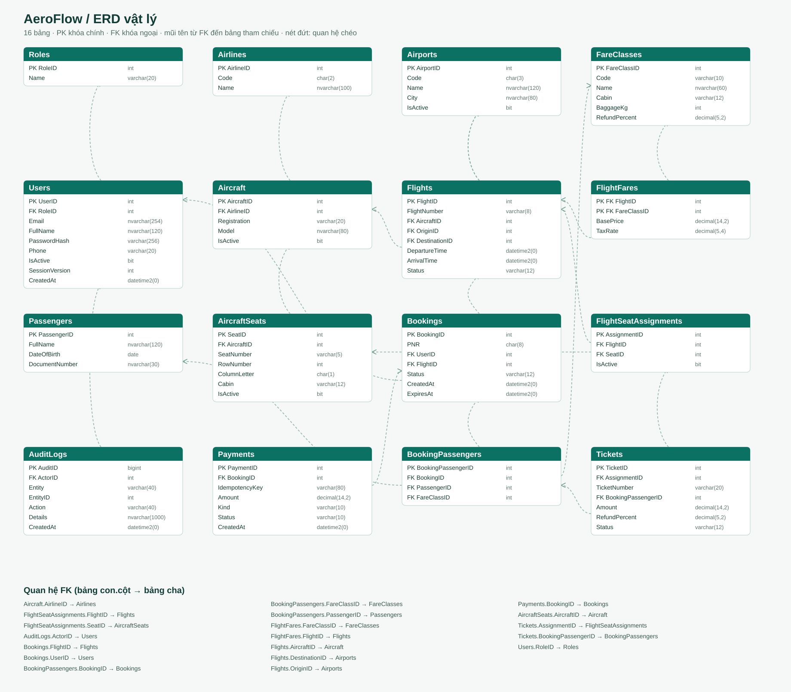

# Lược đồ dữ liệu AeroFlow

[Mở ảnh vector để phóng to](ERD.svg). Lược đồ khớp với `sql/02_create_tables.sql`; quan hệ vé, chặng và ghế còn được kiểm tra trong `sql/08_triggers.sql`.

## Đọc lược đồ

- **PK** là khóa chính, **FK** là khóa ngoại, **UQ** là giá trị duy nhất. Hai cột của `FlightFares` cùng tạo một khóa chính ghép.
- Mũi tên trong ảnh đi từ FK đến bảng cha. Đích tham chiếu ghi ngay dưới FK; bấm vào tên đích để tìm bảng trong ảnh vector.
- Chỉ các cột có chữ **NULL** được phép bỏ trống: `Users.Phone`, `AuditLogs.ActorID` và `AuditLogs.Details`. Các cột khác bắt buộc có giá trị.
- Thời gian lịch bay và giao dịch lưu bằng UTC; `Airports.IanaTimeZone` dùng để đổi sang giờ địa phương khi hiển thị.

| Nhóm | Bảng |
| --- | --- |
| Tài khoản & nhật ký | `Roles`, `Users`, `AuditLogs` |
| Chuyến bay & giá vé | `Airports`, `Airlines`, `Aircraft`, `AircraftSeats`, `Flights`, `FlightFares`, `FareClasses`, `FlightSeatAssignments` |
| Đặt chỗ & thanh toán | `Bookings`, `BookingSegments`, `Passengers`, `BookingPassengers`, `Tickets`, `Payments` |

## Quan hệ và kiểu dữ liệu

Ký hiệu `||` là đúng một, `|o` là không hoặc một, `o{` là không hoặc nhiều. Đây là số lượng được FK cho phép ở mức cấu trúc. Quy tắc đặt chỗ bắt buộc có 1–2 chặng được thực hiện thêm bằng thủ tục đặt vé.

```mermaid
erDiagram
    direction LR
    Roles {
        int RoleID PK "int NOT NULL"
        varchar(20) Name UK "varchar(20) NOT NULL"
    }
    Users {
        int UserID PK "int NOT NULL"
        int RoleID FK "int NOT NULL; Roles.RoleID"
        nvarchar(254) Email UK "nvarchar(254) NOT NULL"
        nvarchar(120) FullName "nvarchar(120) NOT NULL"
        varchar(256) PasswordHash "varchar(256) NOT NULL"
        varchar(20) Phone "varchar(20) NULL"
        bit IsActive "bit NOT NULL"
        int SessionVersion "int NOT NULL"
        datetime2(0) CreatedAt "datetime2(0) NOT NULL"
    }
    Airports {
        int AirportID PK "int NOT NULL"
        char(3) Code UK "char(3) NOT NULL"
        nvarchar(120) Name "nvarchar(120) NOT NULL"
        nvarchar(80) City "nvarchar(80) NOT NULL"
        nvarchar(80) CountryName "nvarchar(80) NOT NULL"
        nvarchar(64) IanaTimeZone "nvarchar(64) NOT NULL"
        bit IsActive "bit NOT NULL"
    }
    Airlines {
        int AirlineID PK "int NOT NULL"
        char(2) Code UK "char(2) NOT NULL"
        nvarchar(100) Name "nvarchar(100) NOT NULL"
    }
    Aircraft {
        int AircraftID PK "int NOT NULL"
        int AirlineID FK "int NOT NULL; Airlines.AirlineID"
        varchar(20) Registration UK "varchar(20) NOT NULL"
        nvarchar(80) Model "nvarchar(80) NOT NULL"
        bit IsActive "bit NOT NULL"
    }
    FareClasses {
        int FareClassID PK "int NOT NULL"
        varchar(10) Code UK "varchar(10) NOT NULL"
        nvarchar(60) Name "nvarchar(60) NOT NULL"
        varchar(12) Cabin "varchar(12) NOT NULL"
        int BaggageKg "int NOT NULL"
        decimal RefundPercent "decimal(5,2) NOT NULL"
    }
    AircraftSeats {
        int SeatID PK "int NOT NULL"
        int AircraftID FK "int NOT NULL; Aircraft.AircraftID"
        varchar(5) SeatNumber "varchar(5) NOT NULL"
        int RowNumber "int NOT NULL"
        char(1) ColumnLetter "char(1) NOT NULL"
        varchar(12) Cabin "varchar(12) NOT NULL"
        bit IsActive "bit NOT NULL"
        decimal SeatFee "decimal(14,2) NOT NULL"
        bit IsPriority "bit NOT NULL"
    }
    Flights {
        int FlightID PK "int NOT NULL"
        varchar(8) FlightNumber "varchar(8) NOT NULL"
        int AircraftID FK "int NOT NULL; Aircraft.AircraftID"
        int OriginID FK "int NOT NULL; Airports.AirportID"
        int DestinationID FK "int NOT NULL; Airports.AirportID"
        datetime2(0) DepartureTime "datetime2(0) NOT NULL"
        datetime2(0) ArrivalTime "datetime2(0) NOT NULL"
        varchar(12) Status "varchar(12) NOT NULL"
    }
    FlightFares {
        int FlightID PK, FK "int NOT NULL; Flights.FlightID"
        int FareClassID PK, FK "int NOT NULL; FareClasses.FareClassID"
        decimal BasePrice "decimal(14,2) NOT NULL"
        decimal TaxRate "decimal(5,4) NOT NULL"
    }
    Passengers {
        int PassengerID PK "int NOT NULL"
        nvarchar(120) FullName "nvarchar(120) NOT NULL"
        date DateOfBirth "date NOT NULL"
        nvarchar(30) DocumentNumber "nvarchar(30) NOT NULL"
    }
    Bookings {
        int BookingID PK "int NOT NULL"
        char(8) PNR UK "char(8) NOT NULL"
        int UserID FK "int NOT NULL; Users.UserID"
        varchar(12) Status "varchar(12) NOT NULL"
        datetime2(0) CreatedAt "datetime2(0) NOT NULL"
        datetime2(0) ExpiresAt "datetime2(0) NOT NULL"
    }
    BookingSegments {
        int BookingSegmentID PK "int NOT NULL"
        int BookingID FK "int NOT NULL; Bookings.BookingID"
        int FlightID FK "int NOT NULL; Flights.FlightID"
        tinyint SegmentOrder "tinyint NOT NULL"
    }
    BookingPassengers {
        int BookingPassengerID PK "int NOT NULL"
        int BookingID FK "int NOT NULL; Bookings.BookingID"
        int PassengerID FK "int NOT NULL; Passengers.PassengerID"
    }
    FlightSeatAssignments {
        int AssignmentID PK "int NOT NULL"
        int FlightID FK "int NOT NULL; Flights.FlightID"
        int SeatID FK "int NOT NULL; AircraftSeats.SeatID"
        bit IsActive "bit NOT NULL"
    }
    Tickets {
        int TicketID PK "int NOT NULL"
        int AssignmentID FK, UK "int NOT NULL; FlightSeatAssignments.AssignmentID"
        varchar(20) TicketNumber UK "varchar(20) NOT NULL"
        int BookingPassengerID FK "int NOT NULL; BookingPassengers.BookingPassengerID"
        int BookingSegmentID FK "int NOT NULL; BookingSegments.BookingSegmentID"
        int FareClassID FK "int NOT NULL; FareClasses.FareClassID"
        decimal BaseFare "decimal(14,2) NOT NULL"
        decimal TaxAmount "decimal(14,2) NOT NULL"
        decimal SeatFee "decimal(14,2) NOT NULL"
        int BaggageKg "int NOT NULL"
        decimal Amount "decimal(14,2) NOT NULL"
        decimal RefundPercent "decimal(5,2) NOT NULL"
        varchar(12) Status "varchar(12) NOT NULL"
    }
    Payments {
        int PaymentID PK "int NOT NULL"
        int BookingID FK "int NOT NULL; Bookings.BookingID"
        varchar(80) IdempotencyKey UK "varchar(80) NOT NULL"
        decimal Amount "decimal(14,2) NOT NULL"
        varchar(10) Kind "varchar(10) NOT NULL"
        varchar(10) Status "varchar(10) NOT NULL"
        datetime2(0) CreatedAt "datetime2(0) NOT NULL"
    }
    AuditLogs {
        bigint AuditID PK "bigint NOT NULL"
        int ActorID FK "int NULL; Users.UserID"
        varchar(40) Entity "varchar(40) NOT NULL"
        int EntityID "int NOT NULL"
        varchar(40) Action "varchar(40) NOT NULL"
        nvarchar(1000) Details "nvarchar(1000) NULL"
        datetime2(0) CreatedAt "datetime2(0) NOT NULL"
    }
    Roles ||..o{ Users : "RoleID"
    Airlines ||..o{ Aircraft : "AirlineID"
    Aircraft ||..o{ AircraftSeats : "AircraftID"
    Aircraft ||..o{ Flights : "AircraftID"
    Airports ||..o{ Flights : "OriginID"
    Airports ||..o{ Flights : "DestinationID"
    Flights ||--o{ FlightFares : "FlightID"
    FareClasses ||--o{ FlightFares : "FareClassID"
    Users ||..o{ Bookings : "UserID"
    Bookings ||..o{ BookingSegments : "BookingID (0..2 chặng)"
    Flights ||..o{ BookingSegments : "FlightID"
    Bookings ||..o{ BookingPassengers : "BookingID"
    Passengers ||..o{ BookingPassengers : "PassengerID"
    Flights ||..o{ FlightSeatAssignments : "FlightID"
    AircraftSeats ||..o{ FlightSeatAssignments : "SeatID"
    FlightSeatAssignments ||..o| Tickets : "AssignmentID"
    BookingPassengers ||..o{ Tickets : "BookingPassengerID"
    BookingSegments ||..o{ Tickets : "BookingSegmentID"
    FareClasses ||..o{ Tickets : "FareClassID"
    Bookings ||..o{ Payments : "BookingID"
    Users |o..o{ AuditLogs : "ActorID"
```

Độ chính xác của kiểu `decimal` được ghi trong chú thích cột và trong ảnh vector, ví dụ `decimal(14,2)`.

## Vì sao chỉ cần thêm BookingSegments?

`Bookings` là một đơn của một tài khoản. `BookingSegments` lưu chuyến thuộc đơn: thứ tự 1 là chiều đi, thứ tự 2 là chiều về. Vì vậy `Bookings` không giữ thêm một cột `ReturnFlightID`, và hành khách không cần tạo hai đơn rồi thanh toán hai lần.

`BookingPassengers` nối một đơn với những người đi. `Tickets` nối từng người trong đơn với từng chặng, hạng vé và lần cấp ghế. Ví dụ đơn khứ hồi có 2 hành khách sẽ có **1 Bookings, 2 BookingSegments, 2 BookingPassengers và 4 Tickets**.

## Những ràng buộc cần hiểu khi vấn đáp

1. `Flights.OriginID` khác `DestinationID`; giờ đến phải sau giờ đi.
2. `UNIQUE(BookingID, SegmentOrder)` và `CHECK(SegmentOrder IN (1,2))` giới hạn mỗi đơn tối đa hai chặng. Thủ tục yêu cầu chiều về đảo sân bay đi–đến và khởi hành sau khi chiều đi hạ cánh ít nhất 60 phút.
3. `UNIQUE(BookingPassengerID, BookingSegmentID)` ngăn một hành khách có hai vé trên cùng chặng. Trigger kiểm tra hành khách và chặng cùng thuộc một đơn.
4. Trigger kiểm tra ghế thuộc máy bay của chuyến, lần cấp ghế thuộc đúng chuyến của chặng và khoang ghế phù hợp với hạng vé.
5. Chỉ mục duy nhất có điều kiện `(FlightID, SeatID) WHERE IsActive=1` ngăn bán trùng ghế. Khi hủy hoặc hết hạn, lần cấp ghế cũ ngừng hoạt động; bản ghi vẫn được giữ để tra lịch sử.
6. `Tickets.AssignmentID` duy nhất: một lần cấp ghế chỉ gắn tối đa một vé. Không thể sửa liên kết, giá và quyền lợi của vé đã tạo; vé đã vô hiệu không được khôi phục.
7. Mỗi đơn có tối đa một khoản thu thành công và một khoản hoàn tiền; các lần thanh toán thất bại có thể được lưu riêng. `IdempotencyKey` duy nhất ngăn xử lý trùng một yêu cầu thanh toán.
8. Xác nhận đơn đòi hỏi thanh toán thành công. Vé còn hiệu lực đòi hỏi đơn đã xác nhận và lần cấp ghế đang hoạt động.

## Chuẩn hóa và dữ liệu lịch sử

Các thực thể được tách theo chức năng: hãng không lặp trong từng chuyến, thông tin máy bay không lặp trong từng ghế, thông tin người đi không lặp cho cả hai chiều. Quan hệ nhiều–nhiều được giải bằng `FlightFares` và `BookingPassengers`. Với khóa ghép của `FlightFares`, giá và thuế phụ thuộc đồng thời vào chuyến và hạng vé, không chỉ một phần khóa.

`Tickets.BaseFare`, `TaxAmount`, `SeatFee`, `BaggageKg` và `RefundPercent` là giá trị đã chốt lúc đặt. Chúng mô tả **vé được bán**, còn `FlightFares`, `FareClasses` và `AircraftSeats` mô tả giá hoặc quy định đang cấu hình. Sửa bảng giá hiện tại không được làm thay đổi vé cũ.

`Tickets.Amount` là tổng lưu sẵn có chủ đích, được `CHECK` bắt buộc bằng `BaseFare + TaxAmount + SeatFee`. Đây là giá trị dẫn xuất có kiểm soát; không nên nói mọi cột của bảng này đều độc lập hoặc khẳng định đây là 3NF thuần túy không có dữ liệu dẫn xuất. Khi giải thích chuẩn hóa, cần tách thiết kế các thực thể khỏi quyết định lưu tổng và ảnh chụp giá để giữ lịch sử.
